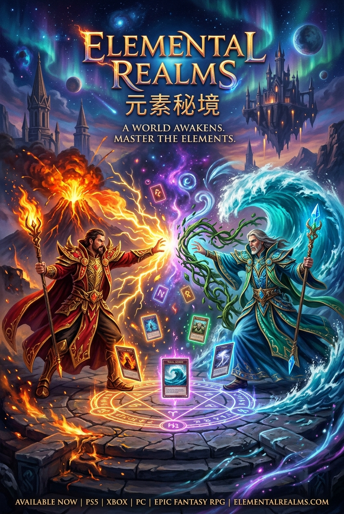

# 元素秘境 · 魔导对决 (Elemental Realms)

<div align="center">



**古典奇幻油画美学 · 六槽位深度博弈 · 真·大模型战术下棋 · 跨平台魔导对决卡牌游戏**

[](#)
[](#)
[](#)
[](#)
[](./CHANGELOG.md)

</div>

---

## 🌟 游戏全景概览 (Overview)

《元素秘境 · 魔导对决》（Elemental Realms）是一款专注于**纯粹智谋交锋**的高阶策略对战卡牌游戏。游戏开创性地舍弃了传统 TCG/CCG 依赖随机抽牌的运气成分，以独特的**“五系元素自增长”**与**“六槽位阵线攻防”**为核心，让胜负完全取决于玩家在资源周转、流派连携以及大局研判上的长远算力。

* **六槽位阵线对冲**：双方各有 6 个独立槽位布局从者或施展魔法。就绪随从自动与正对位敌方交锋；若正对位空虚，凌厉攻势将直接穿透轰击敌方英雄本体。
* **五系能量动态自增长**：火、水、气、土四大自然元素能量与流派专属的第五秘能每回合自动积蓄成长。所有手牌根据当前元素存量即时点亮，节奏张弛有度。
* **15 大魔导学派与 233 张全量卡牌**：涵盖巫术、死灵、圣殿、机械、心灵支配、混沌狂潮、幻术、驯兽、时空、哥布林、德鲁伊、魔像、邪教、鲜血等 15 大独立流派，卡牌命名直观经典，机制丰富深邃。
* **真·AI 大模型自主下棋心智**：全面接入大语言模型（LLM）战术大脑，电脑魔导师依据完整战局态势快照自主完成全局深度推演、出牌下棋决策与战意传音。

---

## 🎮 六大游戏模式 (Game Modes)

主界面采用优雅大气的 3×2 对称六宫格布局，涵盖单机剧情、竞技争霸、自由对决、卡组自组、多人联机与大模型观战：

```
┌─────────────────────────┬─────────────────────────┬─────────────────────────┐
│     🏰 史诗战役推演     │     🏆 英雄大师联赛     │     ⚔️ 经典单局对决     │
│   (3大陆23关·大地图星门)│ (20位魔导师·真实战规特技)│  (自由难度·场景法则定制) │
├─────────────────────────┼─────────────────────────┼─────────────────────────┤
│    🎴 自组卡组实测      │    🌐 双人联机对战      │    🔮 AI 巅峰对决       │
│  (自由搭配20张专属套牌) │  (WebRTC免服务器P2P秒连)│ (大模型自主博弈·上帝观战)│
└─────────────────────────┴─────────────────────────┴─────────────────────────┘
```

### 1. 🔮 AI 巅峰对决 (AI Peak Showdown)
* **人机智斗模式**：人类魔导师向高阶大模型 AI 发起极限智谋挑战，体验顶尖电竞级算力对抗。
* **神谕上帝观战模式**：配置两位大模型魔导师坐镇棋盘两侧，玩家以全知视角坐观双方大模型互相博弈推演、见招拆招、即兴心理战交锋。
* **专属赛后推演结算**：配备专为 AI 巅峰对决打造的结算仪式，支持一键「再次推演/整军再战」与即时参数调整。

### 2. 🏰 史诗战役 (Campaign)
* **三大战区与全 23 场剧情推演**：横跨三大战区大陆（大陆 I：1~8关；大陆 II：9~16关；大陆 III：17~23关），直面最高导师铎拉克（Dorlak）的终极试炼。
* **古典沙盘大地图**：以 2000 年代经典 CRPG 战棋风格重绘三张全景油画沙盘地图，全 23 处战役关卡节点与地貌建筑 100% 严丝合缝对齐。
* **双向传送星门与特殊胜负战规**：通关战区节点开启脉冲传送星门，支持多大陆自由跃迁；接入守护、限回击杀、特殊随从入场等丰富剧情战规。

### 3. 🏆 英雄大师联赛 (Master League)
* **20 位传奇魔导师真实特技**：阿姆哈特（多从者开局）、弗沃尔（天灵蜂皇蜂巢）、富塔克（突进石对峙）、杜斯坦（九阶法术汲魂治愈）等数十位传奇魔导师拥有专属特技战规与独特开局阵容。
* **选手档案与大循环积分**：自建选手档案与肖像，在多级联赛榜单中展开激烈升降级争霸。

### 4. ⚔️ 经典单局对决 (Single Duel)
* **20 位传奇魔导师尊名与人设自选**：告别千篇一律的电脑对手，自由挑选对阵名宿。
* **阶梯式战术指引**：支持「容易」（新手趣味对练）、「普通」（稳扎稳打）、「困难」（斩杀线算计与控场）到「大师」（Alpha-Beta 极值博弈最优解）四档 AI 难度。

### 5. 🎴 自组卡组实测 (Custom Deck Hub & Builder)
* 自由挑选主修流派，在丰富牌库中自由构筑并保存多套 20 张专属卡组，直接投入实战验证套牌强度。

### 6. 🌐 双人联机对战 (P2P Multiplayer)
* 基于 WebRTC DataChannel (PeerJS) 构建无中央服务端直连网络通道，输入 6 位房间码即可实现跨设备、跨局域网超低延迟实时决斗。

### 📼 战局录像馆 (Replay Chronicle)
* 全程记录对局动作时序（召唤、施法、伤害数值、受击反馈），支持随时回放复盘。

---

## 🤖 突破性 AI 大模型心智体系 (LLM Strategic Engine)

不同于传统卡牌游戏的静态脚本，本作深度融合现代大语言模型，构建了全链路 AI 决策与人设交互系统：

```
  ┌─────────────────────────────────────────────────────────┐
  │                 全景牌桌态势快照生成器                  │
  │   - 双方当前生命值与 5 系元素能量储备                   │
  │   - 6 个槽位攻防生命、飞行、魔免、眩晕状态              │
  │   - 当前手牌中全部合法可打出的从者与法术选项            │
  └───────────────────────────┬─────────────────────────────┘
                              ▼
  ┌─────────────────────────────────────────────────────────┐
  │             大语言模型心智推演 (LLM Agent)              │
  │   - 注入对手专属性格、语气、战术偏好 (阿姆哈特/杜斯坦...)│
  │   - 评估场面威胁、计算斩杀线与元素周转收益              │
  └───────────────────────────┬─────────────────────────────┘
                              ▼
  ┌─────────────────────────────────────────────────────────┐
  │           结构化 JSON 指令输出 & 严格合法性验证         │
  │  {                                                      │
  │    "thought": "己方孤祭难支，九火换全场清杀...",        │
  │    "action": "play_card",                               │
  │    "cardId": "fire_inferno",                            │
  │    "targetSlot": 0,                                     │
  │    "banter": "烈焰涤尘，尔等萤火尽归虚无！"             │
  │  }                                                      │
  └───────────────────────────┬─────────────────────────────┘
                              ▼
  ┌─────────────────────────────────────────────────────────┐
  │           自主执行出牌/跳轮 + 顶层战意传音卷轴          │
  │   - 引擎毫秒级安全校验，异常或超时无缝回退本地启发式    │
  │   - 专属古羊皮纸卷轴弹窗，字号清晰饱满，顶格绝不遮挡    │
  └─────────────────────────────────────────────────────────┘
```

* **主流服务商即插即用**：支持 DeepSeek 官方推荐（含 DeepSeek-V3 / DeepSeek-R1 推理模型）、硅基流动（SiliconFlow）、本地私有 Ollama 及任意标准 OpenAI 兼容接口。
* **思考链（Reasoning Chain）深度兼容**：内置高容错多层降级语义解析器（`parseAiScenarioJson` / `parseAiDecisionJson`），自动过滤与修补未闭合 `<think>` 标签，token 上限大幅放宽至 3072，即使长思维链模型也绝不报错截断。
* **分级双层开关架构**：
  * **Tier 1（全局总控）**：开启后即刻激活【🔮 AI 巅峰对决】；
  * **Tier 2（常规模式范围）**：细化勾选单人对战、联赛、战役、卡组实测是否接入大模型，未勾选模式自动采用 0 延迟、0 流量的纯本地原生启发式算法。
* **全流程遥测黑匣子**：所有调用的 System Prompt、局势快照、模型原始返回与耗时均实时持久化记录至 `tools/battle_ai_records.txt`，设置弹窗内支持一键直接导出。

---

## 🗺️ 战场场景与 AI 场景造物工坊 (Battlefield Scenarios & AI Architect)

* **25+ 款内置奇幻场景与特色环境法则**：
  * 【永雨之地】：全场卡牌费用 +2，跳轮受到 5 点环境反噬；
  * 【抑魔双倍场】：法力消耗翻倍，考验极限控蓝；
  * 【熔岩炼狱 / 天界圣峰 / 机械要塞 / 极地冰冠 / 恶臭沼泽】：各自具备专属环境法则与开局预置守护生物。
* **✨ AI 场景创世造物神殿**：
  * 只需输入一句话构想（或点选极地冰封王座、远古地心锻炉、苍穹狂雷圣峰等预设），大模型即刻推演构筑完整的场景数据（主题原画、生命值、元素成长修正、开局预置守卫从者与环境法则）。
* **🗺️ 全景场景图鉴与管理**：
  * 采用 `min-height: 165px` 宽适大卡片布局，场景法则文本多行完整清晰呈现；
  * 配备专属高对比**立体鎏金竖向滚动条**，26+ 个场景流畅自如纵向翻阅；
  * 自创场景配备卡片底部高对比「🗑️ 删除场景」大按钮与顶部快捷删除微标，支持自由管理与永久持久化。

---

## ⚖️ 战斗机制与视听体验优化 (Deep Mechanics & Aesthetics)

* **全场卡牌费用实时动态化（Live Dynamic Cost）**：
  * 手牌右上角费用角标告别静态数字，实时反映受【永雨之地】、【抑魔处所】、【时空编织者】等修正后的**最终实收费用**；
  * 费用被环境增加时呈现警示红色辉光（`.cost-increased`），享受减免时呈现翡翠绿光（`.cost-discounted`）；出牌门槛与右侧羊皮纸全链打通。
* **双方 30 秒思考倒计时动态时钟**：
  * 选手头像与姓名旁配备 `clamp(14px, 1.25vw, 17px)` 高清醒目倒计时徽章，剩余 10 秒触发呼吸警示；
  * 废除原先不合理的“跳过敌方”作弊按键，改为规范的“敌方行动”状态指示与系统防超时公正裁决。
* **顶级古典魔导视听**：
  * **100 款写实古典油画肖像**：涵盖各学派元帅、法皇、圣徒与虚空主宰；
  * **50+ 款高精度法术粒子视觉反馈**：雷霆、圣光柱、剧毒水雾、狂熊兽魂、撕裂爪痕等；
  * **好莱坞交响母带与慢放调速**：支持 0.88x 沉稳慢调 / 0.92x 典雅深沉 / 1.0x 原版疾奏三档节奏切换，0.5 秒能量守恒无缝交叉淡入淡出；
  * **8 款 16:9 电影级高清战场背景**，支持每局随机切换。
* **靶向就地局部刷新（In-Place Mutation）**：
  * 角色创建、对战设定、系统设置等全部弹窗彻底淘汰全局推倒重绘，实现 60FPS 丝滑切换，彻底告别弹窗闪烁。

---

## 📜 核心规则概览 (Core Rules)

1. **胜负条件**：对局双方初始生命值通常为 60 点（部分特色场景为 50~90 点），率先将敌方英雄生命降至 0 点即锁定胜局。
2. **法力累积**：每回合开始时，火、水、气、土四大自然元素能量与流派专属第五秘能自动成长增长。
3. **行动决策**：每回合玩家可在召唤随从、施展法术或休整蓄力跳轮（Pass）中做出单一选择。
4. **交锋结算**：回合结算阶段，棋盘上的就绪随从自动攻击正对面的目标；若对位为空，则直接打击敌方英雄本体。

---

## 🛠️ 技术架构 (Technology Stack)

| 领域 | 选用方案 | 核心价值与说明 |
| :--- | :--- | :--- |
| **应用与规则引擎** | TypeScript (ESNext) + 原生响应式 DOM 引擎 | 极致轻量与瞬时响应，零额外重型框架运行时开销 |
| **现代构建工具** | Vite 8 + Rolldown | 毫秒级极速热重载，生产包体积高度压缩 |
| **跨平台移动端容器** | Capacitor 8.5 (Android) | 原生 WebView 硬件加速，触控微调与横竖屏自适应 |
| **PC 桌面端运行环境** | Electron + electron-builder | Windows 沉浸暗黑磨砂标题栏、开机自适应最大化、防多开单例锁 |
| **点对点通讯 (P2P)** | PeerJS (WebRTC DataChannel) | 免中央服务器房间匹配，端到端低延迟加密通信 |
| **音频管线** | Web Audio API + Ogg Opus (64kbps) | 兼顾广播级音质与超低包体积占用（单曲仅 ~1.5MB） |
| **AI 决策与创世** | OpenAI-Compatible API Client | 结构化 Prompt 注入、思维链容灾解析与全流程遥测归档 |

---

## 🚀 快速上手 (Getting Started)

### 1. 开发环境要求
* **Node.js**：v18+ 或 v20+ / v22+
* **包管理工具**：npm / pnpm
* **Android 构建环境**（若需编译 APK）：JDK 17+ 与 Android Studio / Android SDK

### 2. 一键启动脚本 (推荐)
项目根目录下提供了便捷的双击批处理脚本：
* **`start_dev.bat`**：一键环境检测、安装依赖、启动 Vite 服务并自动唤起浏览器打开对局（端口 5174）。
* **`start_preview.bat`**：一键执行 TypeScript 生产编译并在本地开启生产级服务预览。

亦可使用命令行手动运行：
```bash
cd android
npm install
npm run dev
```

### 3. PC 桌面端可执行程序打包 (.exe)
项目已集成完善的 Electron Windows 打包流水线：
* **一键批处理**：根目录下直接双击运行 **`package_pc.bat`**，自动完成前端编译优化与 Electron 打包，产物（NSIS 安装包及免安装绿色便携版）自动输出至根目录 `release_pc/` 文件夹。
* **命令行执行**：
```bash
cd android
npm run electron:build
```

### 4. 编译输出 Android 安装包 (APK)
```bash
cd android
# 1. 编译前端工程
npm run build

# 2. 同步资源至 Android 原生容器
npx cap sync android

# 3. 在 Android Studio 中打开并构建签名 APK
npx cap open android
```

---

## 📂 项目目录结构 (Directory Structure)

```text
ElementalRealms/
├── android/                 # 前端核心工程、构建配置与原生容器
│   ├── src/                 # TypeScript 源代码
│   │   ├── engine/          # 规则引擎、AI 决策树、大模型客户端、音频、网络
│   │   │   ├── game.ts      # 核心对决状态机、伤害结算、实时费用计算
│   │   │   ├── ai_client.ts # 大模型交互、战局推演、场景造物、思维链容灾解析
│   │   │   ├── sound.ts     # 音频管线、无缝交叉淡入淡出、慢放调速
│   │   │   └── network.ts   # P2P 房间匹配与数据通道传输
│   │   ├── data/            # 卡牌库、战役关卡、大师联赛对手元数据
│   │   ├── main.ts          # 应用主入口、路由、UI 交互机、就地无感刷新
│   │   └── style.css        # 响应式布局规范、主题设计系统、动效与滚动条
│   ├── public/              # 静态资源（卡牌立绘、头像、音效、BGM、战场原画）
│   ├── electron/            # Electron PC 桌面端主进程与单例守护
│   ├── index.html           # 应用主 HTML 入口
│   └── vite.config.ts       # Vite 构建与打包配置
├── release_pc/              # Windows PC 端安装包及便携版产物
├── release_apk/             # Android 正式版 APK 安装包
├── tools/                   # 大模型实战遥测记录与测试工具库
│   ├── battle_ai_records.txt# 实战大模型请求/响应全量文本持久化日志
│   ├── test_combat_api.js   # 命令行大模型接口压测脚本
│   └── run_combat_api_test.bat # 一键连通性测试脚本
├── package_pc.bat           # 一键编译并打包 Windows PC 端程序
├── start_dev.bat            # 一键启动开发调试
├── start_preview.bat        # 一键本地生产预览
├── CHANGELOG.md             # 详细版本迭代记录
└── README.md                # 官方说明文档
```

---

## 📝 版本历史 (Changelog)

各版本详细的功能新增、视觉调优、平衡性调整与工程优化，请参阅 [CHANGELOG.md](./CHANGELOG.md)。
